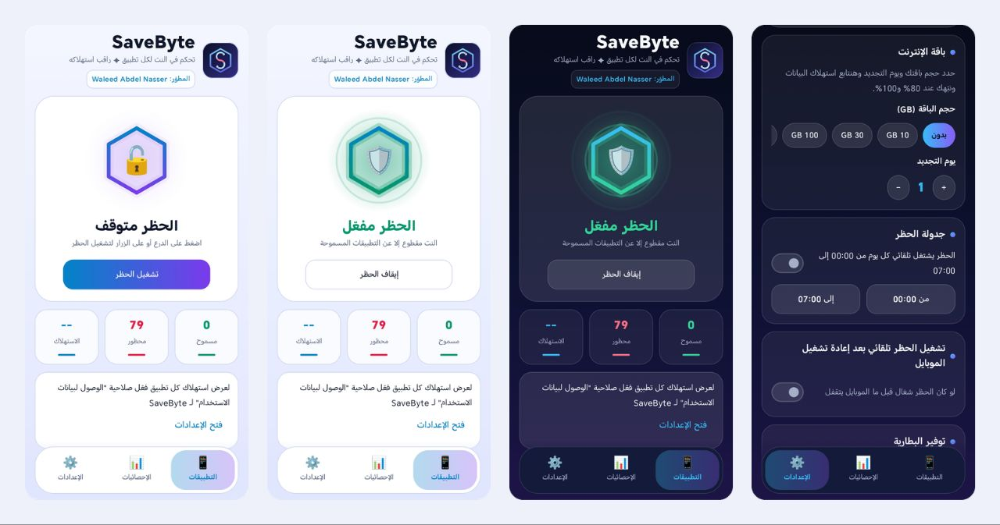

# SaveByte

Free Android app to control which apps can use the internet and track data usage. Everything works on your device: no Internet permission, no ads, no accounts, no analytics.

## Features

**Blocking**
- Choose which apps are allowed or blocked from using the internet
- Detects newly installed apps
- "Important" apps list, profiles, and schedules
- Cut mobile data automatically while roaming
- Blocked-attempt notifications with an "Allow" button
- Connection-attempt log: app name, time, protocol, destination IP and port (Android 10+, kept in memory only, cleared when the app closes or when you tap Clear)
- Blocking restarts after reboot, only if it was on before
- Stop blocking from the app, the notification, the Quick Settings tile, or the widget

**Data usage**
- Per-app usage: today, 7 days, 30 days, Wi-Fi vs. mobile
- Usage alerts and monthly limits
- Data-plan tracking
- Weekly reports

**Extras**
- Optional app lock (biometrics or PIN)
- Theme and language settings
- Export settings (JSON) and usage (CSV) to a place you choose
- Import settings from a file you pick
- "Contact us" button that opens your own email app

## How it works

SaveByte uses Android's `VpnService` only to block internet access for the apps you choose.

- It is a **local** VPN: there is no remote VPN server.
- Your traffic is not forwarded, not read remotely, and not stored.
- While blocking is on, Android shows its standard VPN key icon.

## Permissions

| Permission | Why |
|---|---|
| List of installed apps | Show apps, let you choose which are blocked, detect new apps |
| Usage access (`PACKAGE_USAGE_STATS`) | Per-app usage, alerts, data plan, limits, weekly reports. You enable it yourself and can revoke it any time |
| Network state | Tell Wi-Fi from mobile data, detect roaming |
| Notifications | Blocking status, usage alerts, blocked-attempt notices |
| Biometrics | Optional app lock. Android does the check; the app never sees your fingerprint |
| Boot completed | Restart blocking after reboot |
| Foreground service | Keep blocking active in the background |
| Phone state (Android 8-9 only) | Required by those versions to read mobile-data usage. No calls or phone numbers are read |

SaveByte has **no Internet permission**, so it cannot send your data anywhere.

## Data stored on your device

- Settings, allowed/blocked lists, profiles, schedules, usage limits, data-plan settings, theme and language
- If you set a PIN, only a salted hash is stored, never the PIN itself
- Everything stays in the app's private storage and is removed when you clear the app's data or uninstall it
- Cloud backup is disabled for the app

## Download

Get the latest APK from the [Releases page](../../releases/latest) (`app-SaveByte-V1.0.apk`, about 1.44 MB).

## Requirements

- Android 6.0 or higher

## Installation

1. Download the APK from the Releases page.
2. Open it on your phone.
3. If Android asks, allow installing apps from this source.
4. Open SaveByte and follow the on-screen steps.

## Your control

- Stop blocking at any time.
- Revoke Usage access, notifications, or the VPN permission in Android settings.
- Delete all data: Android Settings, Apps, SaveByte, Storage, Clear data (or uninstall).

## Privacy

SaveByte contains no advertising or analytics services and shares no data with third parties. It is not directed at children and collects no personal information. Read the full [Privacy Policy](https://waleedabdelnaser83-walid.github.io/savebyte/).

## Contact

Developer: Waleed Abdel Nasser
Email: [waleedabdelnaser83@gmail.com](mailto:waleedabdelnaser83@gmail.com)

## Screenshots

  

